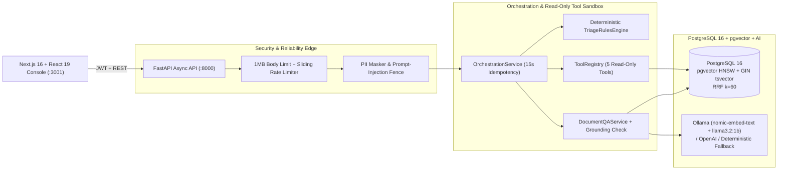

# 🛡️ PayGuard AI — Agentic Payment Dispute Triage & Regulatory RAG Engine

[](pyproject.toml)
[](backend/app/main.py)
[](backend/app/services/retrieval.py)
[](frontend/package.json)
[](frontend/package.json)
[](docker-compose.yml)
[](docs/PROJECT_METRICS.md)
[](LICENSE)

> **Autonomous payment exception triage, read-only tool orchestration, and hybrid `pgvector` + lexical RAG platform for chargeback disputes, gateway timeouts, and regulatory compliance.**

---

## 🎯 At a Glance

**PayGuard AI** (`27,810` non-blank source lines, `18` API route handlers, `6` Alembic migrations) investigates failed payments, duplicate charges, ACH returns, and chargeback disputes against indexed regulatory rulebooks (Visa/Mastercard reason codes, NACHA, refund SLAs) and user-uploaded policy documents—while enforcing strict **non-mutation financial safety**, **multi-tenant isolation**, and **zero-hallucination citation grounding**.

| Engineering Dimension | Architecture & Guardrail | Verified Evidence |
|---|---|---|
| **Financial Non-Mutation** | `ToolRegistry` whitelists 5 strictly read-only tools (`payment_lookup`, `payment_triage`, `knowledge_retrieval`, `investigation_explanation`, `audit`); mutating calls (`issue_refund`, `execute_sql`) raise `ValueError` | Verified in [Phase 8 Report](docs/PHASE_8_TESTING_AND_EVALUATION_REPORT.md) |
| **Gateway Timeout Safety** | Upstream gateway timeouts never guess success or failure—trigger `RULE_GATEWAY_TIMEOUT_UNKNOWN_OUTCOME` (`QUERY_GATEWAY_STATUS`) to prevent double debits | Verified in [Phase 8 Report](docs/PHASE_8_TESTING_AND_EVALUATION_REPORT.md) |
| **Hybrid RAG & Grounding** | PostgreSQL 16 `pgvector` HNSW cosine search + `tsvector`/`ts_rank_cd` GIN full-text search fused via Reciprocal Rank Fusion (`k=60`), hierarchical chunking, and strict abstention (`coverage_ratio < 0.55`) | **`100.0%` Recall@5**, **`1.0000` MRR**, **`40/40`** Ollama eval ([Ollama RAG Audit](docs/OLLAMA_RAG_INDEPENDENT_VERIFICATION_REPORT.md)) |
| **Security & Multi-Tenancy** | `HS256` JWT + role scoping (`support_agent`, `compliance_analyst`, `admin`), IDOR ownership checks, PII masking (`[CARD_REDACTED_*]`), XML prompt-injection fencing, sliding-window rate limits, RFC 7807 errors | **`100%` tenant isolation** (`HTTP 404`/`403` on cross-tenant/IDOR probes) ([Phase 3 Audit](docs/PHASE3_INDEPENDENT_VERIFICATION_REPORT.md)) |
| **Quality & Staging Proof** | `207` test cases across `20` backend modules, Playwright E2E, non-root Docker multi-stage builds, and PostgreSQL `pg_dump`/`pg_restore` disaster recovery | **`181/181`** audited pass, **`8/8`** Playwright E2E ([Staging Report](docs/PHASE_9_STAGING_DEPLOYMENT_REPORT.md)) |

---

## 🏗️ System Architecture



### Key Subsystems
- **Deterministic Payment Triage (`backend/app/services/triage.py`, `orchestration.py`):** Classifies payment anomalies (gateway timeouts, ACH NACHA `R01`/`R02`, duplicate 60s charges, Visa Condition `10.4`) with 15-second per-user idempotency deduplication and immutable `audit_events` logging.
- **Hierarchical Chunking & Hybrid Retrieval (`backend/app/services/chunker.py`, `retrieval.py`, `ingestion.py`):** Supports PDF (`pypdf`) and Markdown/text uploads with magic-byte & 10 MB payload validation, cascading deletions, `pgvector` HNSW cosine search, and PostgreSQL GIN `tsvector` lexical search fused via RRF (`k=60`).
- **Grounded Synthesis & Abstention (`backend/app/services/document_qa.py`, `grounding.py`, `llm.py`):** Cross-references every cited chunk ID against retrieved provenance, neutralizes indirect prompt injections inside retrieved documents, and abstains cleanly when evidence coverage is insufficient. Works offline in deterministic mode, with local **Ollama** (`nomic-embed-text` + `llama3.2:1b`), or with **OpenAI** (`text-embedding-3-small` + `gpt-4o-mini`).
- **Hardened API & Operations Console (`backend/app/core/`, `frontend/`):** Enforces `RequestBodyLimitMiddleware`, security response headers (`nosniff`, `DENY`, `CSP`), `X-Request-ID` tracing, and a 10-route Next.js 16 + React 19 dashboard.

---

## 🛠️ Tech Stack

- **Backend & Async Data:** Python `3.11+` (`pyproject.toml`), FastAPI `0.115+`, Uvicorn, Pydantic v2, SQLAlchemy 2 Async (`asyncpg`), Alembic (`6` migrations, head `3f8a91b2c4d5`), `PyJWT`, `bcrypt`, `pypdf`
- **Database & Hybrid Search:** PostgreSQL 16 (`pgvector/pgvector:pg16`) with HNSW vector indexes and GIN full-text search
- **AI / RAG:** Local Ollama (`nomic-embed-text`, `llama3.2:1b`), OpenAI-compatible HTTPX client, deterministic offline synthesis fallback
- **Frontend:** Next.js `16.4.3` (Turbopack), React `19.3.0`, TypeScript 5, Tailwind CSS v4, Lucide React
- **Testing & Ops:** Pytest + `pytest-asyncio` (`207` test cases across `20` files), Playwright E2E, multi-stage non-root Docker Compose (`docker-compose.yml` & `docker-compose.staging.yml`), automated `PROJECT_METRICS.md` GitHub Actions workflow

---

## 🚀 Quickstart

### Option 1: Docker Compose (Recommended)
```bash
cp .env.example .env
docker compose up --build
```
- **Operations Console:** `http://localhost:3001`
- **FastAPI Swagger Docs:** `http://localhost:8000/docs`
- **Health Check:** `http://localhost:8000/api/v1/health`

### Option 2: Local Development
1. Start PostgreSQL 16 with `pgvector`:
   ```bash
   docker compose up -d db
   ```
2. Install Python dependencies, migrate, and seed sample accounts, payments, and regulatory documents:
   ```bash
   uv sync --extra dev
   uv run alembic upgrade head
   uv run python -m backend.app.scripts.seed_data
   uv run uvicorn backend.app.main:app --host 127.0.0.1 --port 8000 --reload
   ```
3. Start the Next.js console:
   ```bash
   cd frontend
   npm install
   npm run dev -- -p 3001
   ```

---

## 🧪 Verification & Test Suites

```bash
# Full backend unit, integration, and security test suite (207 cases across 20 modules)
uv run pytest backend/tests -v

# Frontend type-check, production build, and Playwright E2E
cd frontend && npm run build && npm run test:e2e

# RAG evaluation and DB migration reversibility scripts
uv run python scripts/verify_rag_rigorous_evaluation.py
uv run python scripts/verify_disposable_migration.py
```

### Engineering & Audit Reports
- [Project Metrics (Auto-Refreshed)](docs/PROJECT_METRICS.md) — `27,810` non-blank source lines, `207` test cases, `18` API routes, `6` Alembic migrations
- [Ollama RAG Independent Verification Report](docs/OLLAMA_RAG_INDEPENDENT_VERIFICATION_REPORT.md) — `32/32` baseline + `40/40` expanded suite (`100%` Recall@5, `1.0000` MRR), `181/181` tests passing
- [Phase 3 Independent Verification & Hardening Audit](docs/PHASE3_INDEPENDENT_VERIFICATION_REPORT.md) — `178/178` audited pass, IDOR & cascade deletion fixes, disposable migration round-trip
- [Phase 8 Testing & Evaluation Report](docs/PHASE_8_TESTING_AND_EVALUATION_REPORT.md) — `8/8` Playwright E2E, read-only tool sandbox, gateway timeout non-mutation
- [Phase 9 Staging Deployment Report](docs/PHASE_9_STAGING_DEPLOYMENT_REPORT.md) — Non-root Docker staging, persistence across restarts, `pg_dump`/`pg_restore` verification
- [Pre-Deployment Readiness Report](docs/PRE_DEPLOYMENT_READINESS_REPORT.md) & [Phase 6 Security Report](docs/PHASE_6_SECURITY_RELIABILITY_REPORT.md)

---

## 📂 Repository Structure

```text
PayGuard-AI-Agentic-Payment-Triage-RAG-Engine/
├── alembic/                  # 6 PostgreSQL 16 + pgvector schema/HNSW/GIN migrations
├── backend/
│   ├── app/
│   │   ├── api/              # auth, health, investigations, knowledge, payments routers
│   │   ├── core/             # config, async DB, RFC 7807 errors, rate limiter, JWT/PII security
│   │   ├── models/           # SQLAlchemy ORM models (payments, investigations, knowledge, audit)
│   │   ├── schemas/          # Pydantic v2 request/response contracts
│   │   ├── scripts/          # seed_data.py, eval_retrieval.py, E2E verification scripts
│   │   └── services/         # orchestration, triage, retrieval, chunker, grounding, tools, llm
│   └── tests/                # 20 pytest test modules (207 test cases)
├── frontend/                 # Next.js 16 + React 19 operations console & Playwright E2E
├── scripts/                  # RAG benchmark harnesses, migration checks, backup/restore scripts
├── docs/                     # Independent verification audits, architecture & UI specs
├── docker-compose.yml        # Local PostgreSQL 16 (pgvector), FastAPI backend, Next.js frontend
└── docker-compose.staging.yml# Non-root multi-stage staging deployment
```

---

## 📄 License

This project is licensed under the MIT License — see the [LICENSE](LICENSE) file for details.
