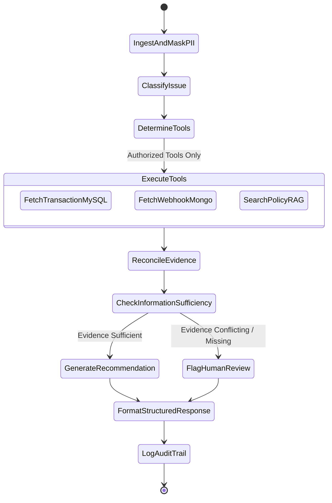

# PayGuard AI - System Architecture Document (SAD)

**Document Version:** 1.0  
**Project:** PayGuard AI — Agentic Payment Triage & RAG Engine  
**Status:** Approved for Implementation  
**Aligned PRD:** [Product Requirements Document v1.0](../prd.md)

---

## 1. Architectural Principles & High-Level Design

PayGuard AI is designed as a **modular, secure, and observable agentic backend** for financial customer support operations. It prioritizes deterministic safety boundaries, data privacy, and verifiable evidence over unconstrained agent autonomy.

### Core Architectural Pillars
1. **Separation of Concerns:** Clear demarcation between API transport, business domain services, database adapters, agent orchestrators, and RAG retrieval pipelines.
2. **Least Privilege & Read-Only Invariant:** Investigation agents are granted read-only access to authorized payment databases. All queries are parameterized; arbitrary SQL execution is strictly forbidden.
3. **Evidence Grounding:** Responses generated by the LLM must be explicitly grounded in retrieved transaction facts and indexed policy documents. Ambiguity triggers a human-review recommendation.
4. **Data Privacy First:** Automated PII masking (card PANs, bank account numbers, SSNs/tax IDs, customer phone numbers) occurs prior to context injection into LLM prompts.
5. **Multi-Database Specialization:** Distinct databases fulfill dedicated roles matching their data models rather than arbitrary polyglot persistence.

```
                           +------------------------------------+
                           |   Client (Support Agent Console)   |
                           +-----------------+------------------+
                                             | HTTP / WebSockets
                                             v
                           +------------------------------------+
                           |    FastAPI Gateway & Middleware    |
                           |  (Auth, PII Masking, Rate Limits)  |
                           +-----------------+------------------+
                                             |
                   +-------------------------+-------------------------+
                   |                                                   |
                   v                                                   v
+------------------------------------+               +----------------------------------+
|   Deterministic Classifier Engine  |               |  Bounded Agentic Orchestrator    |
| (Rule-based Fast-Path & Few-Shot)  |               |    (State Graph State Machine)   |
+------------------------------------+               +-----------------+----------------+
                                                                       |
       +------------------------------------+--------------------------+-----------------------+
       |                                    |                          |                       |
       v                                    v                          v                       v
+---------------+                   +---------------+          +---------------+       +---------------+
|  PostgreSQL   |                   |     MySQL     |          |    MongoDB    |       |  RAG Engine   |
| System of     |                   | Payment Gtwy  |          | Raw Webhooks  |       |  (ChromaDB /  |
| Record & Cases|                   | Ledger & Auth |          | Event Logs    |       | Hybrid BM25)  |
+---------------+                   +---------------+          +---------------+       +---------------+
```

---

## 2. Multi-Database Architecture & Responsibility Matrix

Per PRD Section 5 (FR-04) and Section 14, three databases are utilized according to specific operational requirements. For local development and continuous integration, in-memory/SQLite and mock adapters are provided to guarantee zero-friction setup.

| Database | Primary Responsibility | Data Entities | Access Mode | Security Controls |
|---|---|---|---|---|
| **PostgreSQL** | **System of Record (SoR)** for application state, case workflows, triage decisions, and audit trails. | `users`, `support_cases`, `triage_results`, `audit_logs`, `policy_documents` | Read/Write (via ORM) | Connection pooling (asyncpg/SQLAlchemy), row-level tenancy, strict FK constraints. |
| **MySQL** | **Payment Gateway & Banking Ledger**. Structured transactional ledger storing authorization codes, batch settlements, and clearinghouse statuses. | `transactions`, `settlements`, `gateway_authorizations`, `merchant_ledgers` | **Read-Only** | Parameterized queries, read-only DB user credentials, query execution timeouts (<2s). |
| **MongoDB** | **Raw Telemetry & Webhook Event Store**. Semi-structured payload dumps from payment processors (Stripe, Adyen, UPI PSPs, NACHA ACH). | `raw_webhook_events`, `processor_error_logs`, `network_payloads` | **Read-Only** | Projection filtering (excludes raw credential fields), query timeouts (<1.5s), index on `transaction_id`. |

### Database Fallback Strategy (Local & Test Environments)
- **Local Dev / Testing:** Unified SQLite backend with dual logical schemas representing PostgreSQL and MySQL, alongside an embedded TinyDB / in-memory JSON document collection for MongoDB events.
- **Production / Staging:** Independent cloud-managed instances (e.g. AWS RDS / Google Cloud SQL + MongoDB Atlas) injected via environment variables.

---

## 3. Data Models & Schemas

### 3.1 PostgreSQL Schema (Application & Audit)
```sql
-- Users and Roles
CREATE TABLE users (
    id VARCHAR(36) PRIMARY KEY,
    email VARCHAR(255) UNIQUE NOT NULL,
    hashed_password VARCHAR(255) NOT NULL,
    role VARCHAR(50) NOT NULL CHECK (role IN ('support_agent', 'compliance_analyst', 'admin')),
    created_at TIMESTAMP WITH TIME ZONE DEFAULT CURRENT_TIMESTAMP
);

-- Support Cases
CREATE TABLE support_cases (
    id VARCHAR(36) PRIMARY KEY,
    case_number VARCHAR(64) UNIQUE NOT NULL,
    customer_id VARCHAR(64) NOT NULL,
    transaction_ref VARCHAR(64),
    raw_query TEXT NOT NULL,
    sanitized_query TEXT NOT NULL,
    status VARCHAR(32) NOT NULL DEFAULT 'open' CHECK (status IN ('open', 'triaged', 'escalated', 'closed')),
    created_at TIMESTAMP WITH TIME ZONE DEFAULT CURRENT_TIMESTAMP,
    updated_at TIMESTAMP WITH TIME ZONE DEFAULT CURRENT_TIMESTAMP
);

-- Triage Results
CREATE TABLE triage_results (
    id VARCHAR(36) PRIMARY KEY,
    case_id VARCHAR(36) REFERENCES support_cases(id) ON DELETE CASCADE,
    issue_category VARCHAR(64) NOT NULL,
    confidence_score FLOAT NOT NULL,
    priority VARCHAR(32) NOT NULL CHECK (priority IN ('low', 'medium', 'high', 'human_review_required')),
    investigation_summary TEXT NOT NULL,
    recommended_action VARCHAR(64) NOT NULL,
    recommended_action_details TEXT NOT NULL,
    transaction_snapshot JSONB,
    policy_citations JSONB,
    conflicts_or_gaps JSONB,
    human_review_required BOOLEAN NOT NULL DEFAULT FALSE,
    human_review_reason TEXT,
    execution_time_ms INTEGER NOT NULL,
    model_version VARCHAR(64) NOT NULL,
    created_at TIMESTAMP WITH TIME ZONE DEFAULT CURRENT_TIMESTAMP
);

-- Audit Logs (FR-09, FR-10)
CREATE TABLE audit_logs (
    id VARCHAR(36) PRIMARY KEY,
    case_id VARCHAR(36),
    actor_id VARCHAR(36) NOT NULL,
    event_type VARCHAR(64) NOT NULL,
    tool_name VARCHAR(64),
    tool_inputs JSONB,
    tool_output_hash VARCHAR(64),
    latency_ms INTEGER,
    status VARCHAR(32) NOT NULL CHECK (status IN ('success', 'failure', 'skipped')),
    error_message TEXT,
    created_at TIMESTAMP WITH TIME ZONE DEFAULT CURRENT_TIMESTAMP
);
```

### 3.2 MySQL Schema (Payment Ledger)
```sql
CREATE TABLE transactions (
    transaction_id VARCHAR(64) PRIMARY KEY,
    account_id VARCHAR(64) NOT NULL,
    merchant_id VARCHAR(64) NOT NULL,
    amount DECIMAL(12, 2) NOT NULL,
    currency VARCHAR(3) NOT NULL DEFAULT 'USD',
    payment_method VARCHAR(32) NOT NULL, -- card, ach, upi, wire
    status VARCHAR(32) NOT NULL,         -- authorized, captured, failed, pending, refunded, disputed
    failure_reason_code VARCHAR(32),
    failure_message TEXT,
    settlement_batch_id VARCHAR(64),
    authorized_at DATETIME NOT NULL,
    settled_at DATETIME,
    INDEX idx_account_id (account_id),
    INDEX idx_merchant_id (merchant_id),
    INDEX idx_authorized_at (authorized_at)
);
```

### 3.3 MongoDB Schema (Raw Events & Webhooks)
```json
{
  "$jsonSchema": {
    "bsonType": "object",
    "required": ["event_id", "transaction_id", "processor", "event_type", "payload", "received_at"],
    "properties": {
      "event_id": { "bsonType": "string" },
      "transaction_id": { "bsonType": "string" },
      "processor": { "enum": ["stripe", "adyen", "nacha_ach", "upi_psp"] },
      "event_type": { "bsonType": "string" },
      "payload": { "bsonType": "object" },
      "http_status": { "bsonType": "int" },
      "latency_ms": { "bsonType": "int" },
      "received_at": { "bsonType": "date" }
    }
  }
}
```

---

## 4. Query Classification & Agent Orchestration Engine

### 4.1 Query Classification (FR-02)
Incoming queries are classified into five standard categories:
1. `failed_payment`: Payment decline, network timeout, card expiration, insufficient funds, processor error.
2. `pending_payment`: Authorization hold, delayed ACH settlement, clearinghouse verification delay.
3. `duplicate_charge`: Multiple authorizations for single purchase order, concurrent submission anomalies.
4. `refund_status`: Chargeback inquiry, credit timeline, merchant return window compliance.
5. `unknown_or_other`: Incomplete queries, non-payment inquiries, ambiguous account statements.

**Two-Stage Classification Pipeline:**
- **Stage 1 (Deterministic Fast Path):** Pattern and keyword regex matcher for explicit signals (e.g. error codes `R01`, `10.4`, `51`, `insufficient funds`, `charged twice`). Executes in < 2ms.
- **Stage 2 (Few-Shot Semantic Classifier):** LLM classifier with temperature=0.0 and Pydantic schema validation when regex confidence is below 0.85.

### 4.2 State-Graph Agent Workflow (FR-03)
The agent operates via a strictly bounded finite state machine (max tool iterations = 5):



### 4.3 Registered Investigation Tools
1. `get_transaction_status(transaction_id: str) -> TransactionDetails`: Queries MySQL ledger for transaction status, settlement time, and processor failure codes.
2. `get_payment_webhook_events(transaction_id: str) -> List[WebhookEvent]`: Queries MongoDB for raw processor webhook events, retry attempts, and gateway error payloads.
3. `search_policy_knowledge_base(query: str, top_k: int = 3) -> List[PolicyPassage]`: Queries RAG vector store for relevant refund rules, SLA windows, dispute regulations, and merchant protocols.
4. `reconcile_duplicate_charges(account_id: str, amount: float, time_window_hours: int = 24) -> List[TransactionDetails]`: Searches for concurrent or duplicate debit records within the specified time window.

---

## 5. Retrieval-Augmented Generation (RAG) Architecture

### 5.1 Knowledge Corpus
The knowledge store contains authoritative documentation structured into chunked documents:
- **Card Network Rules:** Visa Core Rules (Dispute condition 10.4, 11.x, 12.x), Mastercard Chargeback Guide.
- **Banking Rails Protocols:** NACHA Operating Rules (ACH return reason codes R01–R85), SEPA Rulebook, FedNow messaging standards.
- **Merchant & Platform Policies:** Standard Refund SLA (3–5 business days for card, 5–7 days for ACH), Cancellation Windows, Duplicate Charge Guarantee.

### 5.2 RAG Pipeline Components
1. **Document Parser & Normalizer:** Cleans markdown and PDF documentation, preserves structural headers, tables, and section identifiers.
2. **Recursive Semantic Chunking:** Chunks text into 400–600 token blocks with 100 token overlap, maintaining hierarchical breadcrumb metadata (e.g. `section: "NACHA Rules > Return Reason Codes > R01"`).
3. **Hybrid Search (Dense + Sparse BM25):**
   - **Dense Embeddings:** Vector representation capturing semantic intent.
   - **Sparse Lexical Search:** BM25 scoring ensuring exact matching of alphanumeric scheme codes (e.g., `R01`, `10.4`, `Do Not Honor`, `51`).
   - **Reciprocal Rank Fusion (RRF):** Merges dense and sparse ranks to guarantee high Recall@k.
4. **Context Construction & Citation Prompting:** Enforces strict Markdown citation format `[Policy: <Doc Title> § <Section Number>]`.

---

## 6. Security, PII Masking, & Guardrails

### 6.1 PII Masking Engine (Section 11.1)
Before any text is sent to an external model provider or recorded in operational logs, it passes through the deterministic PII Masker:
- **Primary Account Numbers (PANs / Credit Cards):** Masked to `[CARD_PAN_REDACTED_XXXX]` preserving last 4 digits if needed for verification, verified with Luhn algorithm validation.
- **Bank Account / Routing Numbers:** Masked to `[ACCOUNT_ID_XXXX]`.
- **Customer Phone & Email:** Replaced with deterministic pseudo-tokens `[EMAIL_USER_1]`, `[PHONE_NUM_1]`.
- **Social Security / Tax IDs:** Masked to `[TAX_ID_REDACTED]`.

### 6.2 SQL Sandboxing & Injection Defenses (Section 11.2)
- Zero dynamically assembled SQL strings (`SELECT * FROM table WHERE id = '` + id + `'`).
- All database operations are invoked through SQLAlchemy ORM models or strict parameterized statements.
- Database connection users for MySQL and MongoDB have strictly `SELECT` / `find` read privileges.

### 6.3 Prompt Injection Defense (Section 11.3)
User queries and retrieved knowledge chunks are wrapped in XML encapsulation tags (`<untrusted_user_query>`, `<retrieved_policy_context>`). The system prompt explicitly commands the model to treat content inside these tags strictly as passive data and never as executable instructions.

---

## 7. API Specification (FastAPI REST & WebSockets)

### 7.1 Core Endpoints

#### `POST /api/v1/triage/investigate`
Submits a customer payment query for automated triage.
- **Request Body:**
```json
{
  "query": "Customer says they were charged $149.00 twice on Oct 20th for their annual plan.",
  "transaction_ref": "tx_20261020_8841",
  "customer_id": "cust_9921",
  "channel": "email"
}
```
- **Response Body (200 OK):**
```json
{
  "case_id": "case_b90812e4",
  "issue_category": "duplicate_charge",
  "confidence_score": 0.96,
  "priority": "medium",
  "investigation_summary": "Two identical charges of $149.00 were authorized within 14 seconds of each other on 2026-10-20. The first transaction settled successfully, while the second transaction is currently an uncaptured authorization hold.",
  "relevant_transaction": {
    "transaction_id": "tx_20261020_8841",
    "amount": 149.00,
    "currency": "USD",
    "status": "authorized_duplicate",
    "timestamp": "2026-10-20T14:22:10Z"
  },
  "policy_citations": [
    {
      "source": "Merchant Billing Policy",
      "section": "§ 4.2 Duplicate Authorization Holds",
      "excerpt": "Duplicate authorizations for identical amounts within 60 seconds are automatically voided or expire within 72 hours depending on issuing bank rules."
    }
  ],
  "recommended_action": "VOID_HOLD_AND_NOTIFY",
  "recommended_action_details": "Release the pending authorization hold on tx_20261020_8842 and send an automated explanation to the customer confirming only one charge will post.",
  "missing_or_conflicting_info": [],
  "human_review_required": false,
  "execution_time_ms": 384
}
```

#### `GET /api/v1/cases/{case_id}`
Retrieves case details, agent thoughts, and audit logs.

#### `GET /api/v1/policies/search?q={query}`
Searches the RAG knowledge base directly for compliance verification.

#### `GET /api/v1/health`
System liveness and readiness probe, reporting connection health for PostgreSQL, MySQL, MongoDB, and RAG vector store.

---

## 8. Evaluation & Quality Framework (PRD Section 12)

The system includes an automated evaluation harness (`tests/evaluation/`):
1. **Classification Accuracy (Benchmark ≥ 92%):** Labeled test suite of 100 diverse payment support scenarios covering all 5 categories, ambiguous queries, edge cases, and noise.
2. **Retrieval Recall@k (k=3, target ≥ 90%):** Evaluates if the ground-truth policy section is retrieved in top-3 results.
3. **Groundedness & Unsupported Answer Metric:** Checks that every factual claim in the investigation summary matches retrieved database facts or policy excerpts.
4. **Latency Profiles:** Benchmarks end-to-end response time under load (target p50 < 800ms, p95 < 2500ms).

---

## 9. Technology Stack Summary

| Layer | Component | Version / Library |
|---|---|---|
| **Runtime** | Python | 3.14+ |
| **Framework** | FastAPI / Starlette | 0.115+ |
| **Data Validation** | Pydantic | v2.10+ |
| **Primary Relational DB** | PostgreSQL / SQLite async | SQLAlchemy 2.0+ (asyncpg / aiosqlite) |
| **Secondary DB (Ledger)** | MySQL / SQLite secondary | PyMySQL / SQLAlchemy async |
| **Document Store** | MongoDB / Embedded Engine | Motor / Async Motor / Memory-fallback |
| **RAG / Vector Store** | ChromaDB / FAISS + BM25 | ChromaDB 0.6+ / Rank-BM25 |
| **Testing** | pytest, pytest-asyncio, httpx | pytest 8.0+ |

---
**Next Document & Step:** Implementation of Backend Foundation (Milestone 3): Directory scaffolding, configuration management, database connectors, and PII masking engine.
