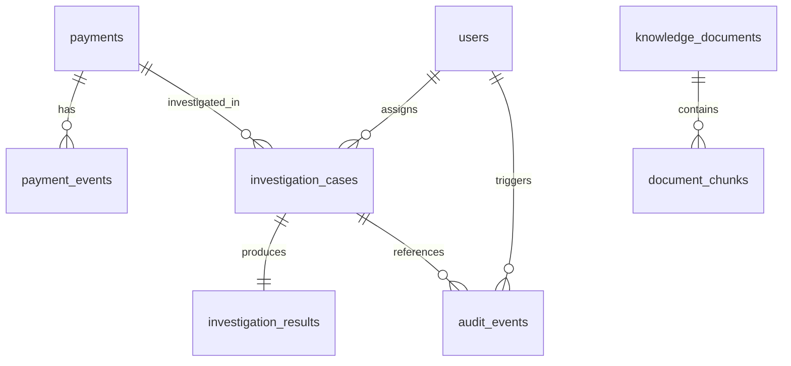
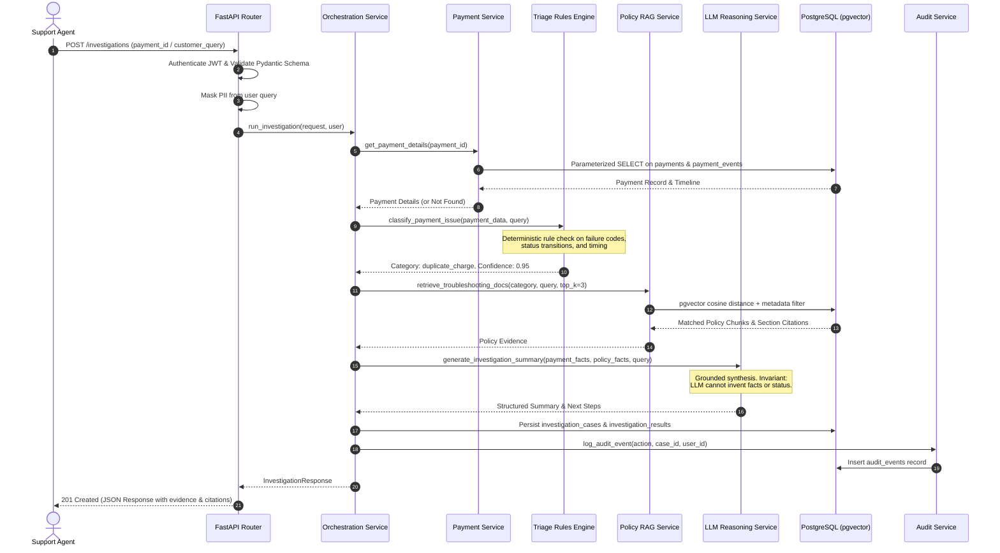

# PayGuard AI - System Architecture Document (Phase 2)

**Project Name:** PayGuard AI — Agentic Payment Triage and RAG Engine  
**Architecture Style:** Practical Modular Monolith  
**Primary Database:** PostgreSQL 16+ with `pgvector`  
**Backend Framework:** Python 3.14+, FastAPI, SQLAlchemy 2.x, Pydantic v2  
**Status:** Architecture Finalized for Implementation (Phase 2 Complete)  

---

## 1. System Overview & Architecture Principles

PayGuard AI is a backend system designed to assist human payment operations engineers and support agents in investigating payment issues (failed transactions, authorization holds, duplicate charges, refund disputes, and network timeouts).

### Core Architectural Decisions:
1. **Modular Monolith:** Single maintainable Python/FastAPI codebase structured by distinct domain boundaries. Avoids distributed microservice complexity.
2. **Unified PostgreSQL Persistence:** PostgreSQL serves as the single source of truth for:
   - Relational application metadata (users, cases, audit logs)
   - Transactional payment records and event histories
   - Semi-structured processor payloads (via PostgreSQL `JSONB`)
   - Vector embeddings for policy retrieval (via `pgvector`)
3. **Deterministic Fast-Path + Grounded LLM:**
   - Classification uses deterministic rule engines first for unambiguous failure codes and error patterns.
   - The LLM reasons over verified database records and retrieved policy chunks.
   - The LLM is **never** granted direct or arbitrary SQL execution access.
   - The LLM cannot invent transaction statuses or execute financial actions.
4. **Security & Privacy Guardrails:**
   - Parameterized queries via SQLAlchemy 2.x.
   - PII masking before data is formatted for LLM prompts or logged to audit stores.
   - Role-based authorization (`support_agent`, `compliance_analyst`, `admin`).
   - Append-only audit logging for all investigation operations.

```
                           +--------------------------------------+
                           |   Client (Support Console / API)     |
                           +------------------+-------------------+
                                              | HTTP / JSON (JWT Auth)
                                              v
                           +--------------------------------------+
                           |       FastAPI Application Layer      |
                           |   (Routes, Request Validation, PII)  |
                           +------------------+-------------------+
                                              |
                                              v
                           +--------------------------------------+
                           |   Investigation Orchestration Layer  |
                           +--------+--------------------+--------+
                                    |                    |
                 +------------------+                    +------------------+
                 v                                                          v
+----------------------------------+                      +----------------------------------+
|      Payment Data Service        |                      |       Policy RAG Service         |
|  (Read-Only Transaction Lookups) |                      |  (pgvector Semantic + Lexical)   |
+----------------+-----------------+                      +-----------------+----------------+
                 |                                                          |
                 |             +------------------------------+             |
                 +------------>|  PostgreSQL 16 + pgvector    |<------------+
                               |                              |
                               | - payments & events (JSONB)  |
                               | - investigation cases        |
                               | - document chunks (vector)   |
                               | - users & audit logs         |
                               +------------------------------+
```

---

## 2. Component Boundaries & Responsibilities

| Component | Responsibility | Public Interface |
|---|---|---|
| **API Routers (`app.api`)** | HTTP transport, request parsing, authentication checks, status code mapping. | FastAPI APIRouter endpoints |
| **Auth & Security (`app.core.security`)** | Password hashing (bcrypt), JWT generation/validation, PII masking. | `verify_password`, `create_access_token`, `mask_pii` |
| **Payment Service (`app.services.payment`)** | Read-only access to payments and event history. Parameterized queries with permission scoping. | `get_payment_details`, `get_payment_history`, `search_payment_records` |
| **Triage Rules Engine (`app.services.triage`)** | Deterministic categorization of payment issues based on gateway codes, status, and rules. | `classify_payment_issue` |
| **RAG Service (`app.services.rag`)** | Semantic vector search and metadata-filtered retrieval over document chunks via pgvector. | `retrieve_troubleshooting_docs` |
| **LLM Reasoning Layer (`app.services.llm`)** | Safe synthesis of evidence into structured investigation summaries. Strictly grounded in context. | `generate_investigation_summary` |
| **Orchestration Service (`app.services.orchestration`)** | Coordinates the investigation pipeline: fetch records -> triage -> RAG -> LLM -> audit log. | `run_investigation` |
| **Audit Service (`app.services.audit`)** | Records structured audit events for every investigation step, query, and tool execution. | `log_audit_event` |

---

## 3. Database Schema (PostgreSQL with pgvector)

All IDs use UUIDv4 for distributed uniqueness.

### 3.1 Entity Relationship Diagram



### 3.2 Table Definitions

1. **`users`**
   - `id` (UUID, PK)
   - `email` (VARCHAR(255), UNIQUE, NOT NULL)
   - `hashed_password` (VARCHAR(255), NOT NULL)
   - `full_name` (VARCHAR(128), NOT NULL)
   - `role` (VARCHAR(32), NOT NULL, CHECK in `support_agent`, `compliance_analyst`, `admin`)
   - `is_active` (BOOLEAN, DEFAULT TRUE)
   - `created_at` (TIMESTAMPTZ, DEFAULT NOW())
   - `updated_at` (TIMESTAMPTZ, DEFAULT NOW())

2. **`payments`**
   - `id` (UUID, PK)
   - `payment_reference` (VARCHAR(64), UNIQUE, NOT NULL, INDEX)
   - `customer_id` (VARCHAR(64), NOT NULL, INDEX)
   - `merchant_id` (VARCHAR(64), NOT NULL, INDEX)
   - `amount` (NUMERIC(12, 2), NOT NULL)
   - `currency` (VARCHAR(3), NOT NULL DEFAULT 'USD')
   - `payment_method` (VARCHAR(32), NOT NULL) -- `credit_card`, `debit_card`, `ach`, `upi`, `wire`
   - `status` (VARCHAR(32), NOT NULL, INDEX) -- `authorized`, `captured`, `failed`, `pending`, `refunded`, `partially_refunded`, `disputed`
   - `gateway_name` (VARCHAR(64), NOT NULL) -- `stripe`, `adyen`, `internal_ledger`
   - `gateway_transaction_id` (VARCHAR(128), INDEX)
   - `failure_code` (VARCHAR(64), NULLABLE) -- e.g. `insufficient_funds`, `do_not_honor`, `card_expired`, `R01`
   - `failure_message` (TEXT, NULLABLE)
   - `metadata` (JSONB, DEFAULT '{}') -- non-sensitive payment metadata
   - `authorized_at` (TIMESTAMPTZ, NULLABLE)
   - `captured_at` (TIMESTAMPTZ, NULLABLE)
   - `created_at` (TIMESTAMPTZ, DEFAULT NOW())
   - `updated_at` (TIMESTAMPTZ, DEFAULT NOW())

3. **`payment_events`** (Status History & Gateway Telemetry)
   - `id` (UUID, PK)
   - `payment_id` (UUID, FK -> `payments.id` ON DELETE CASCADE, INDEX)
   - `event_type` (VARCHAR(64), NOT NULL) -- `authorization_attempt`, `gateway_webhook`, `risk_score_evaluation`, `status_transition`
   - `from_status` (VARCHAR(32), NULLABLE)
   - `to_status` (VARCHAR(32), NOT NULL)
   - `raw_payload` (JSONB, DEFAULT '{}') -- sanitized payload from processor
   - `occurred_at` (TIMESTAMPTZ, NOT NULL, INDEX)
   - `created_at` (TIMESTAMPTZ, DEFAULT NOW())

4. **`investigation_cases`**
   - `id` (UUID, PK)
   - `case_number` (VARCHAR(64), UNIQUE, NOT NULL, INDEX)
   - `payment_id` (UUID, FK -> `payments.id`, NULLABLE, INDEX)
   - `created_by_user_id` (UUID, FK -> `users.id`, INDEX)
   - `customer_query` (TEXT, NOT NULL)
   - `sanitized_query` (TEXT, NOT NULL)
   - `status` (VARCHAR(32), NOT NULL DEFAULT 'open', CHECK in `open`, `in_progress`, `triaged`, `escalated`, `closed`)
   - `priority` (VARCHAR(32), NOT NULL DEFAULT 'medium', CHECK in `low`, `medium`, `high`, `urgent`)
   - `created_at` (TIMESTAMPTZ, DEFAULT NOW())
   - `updated_at` (TIMESTAMPTZ, DEFAULT NOW())

5. **`investigation_results`**
   - `id` (UUID, PK)
   - `case_id` (UUID, FK -> `investigation_cases.id` ON DELETE CASCADE, UNIQUE, INDEX)
   - `issue_category` (VARCHAR(64), NOT NULL) -- `failed_payment`, `pending_payment`, `duplicate_charge`, `refund_status`, `unknown_or_other`
   - `confidence_score` (FLOAT, NOT NULL)
   - `investigation_summary` (TEXT, NOT NULL)
   - `recommended_action` (VARCHAR(64), NOT NULL)
   - `recommended_action_details` (TEXT, NOT NULL)
   - `policy_citations` (JSONB, DEFAULT '[]') -- citations referencing document chunks
   - `missing_or_conflicting_info` (JSONB, DEFAULT '[]')
   - `human_review_required` (BOOLEAN, NOT NULL DEFAULT FALSE)
   - `human_review_reason` (TEXT, NULLABLE)
   - `execution_time_ms` (INTEGER, NOT NULL)
   - `llm_model_name` (VARCHAR(64), NOT NULL)
   - `created_at` (TIMESTAMPTZ, DEFAULT NOW())

6. **`knowledge_documents`**
   - `id` (UUID, PK)
   - `title` (VARCHAR(255), NOT NULL)
   - `doc_type` (VARCHAR(64), NOT NULL) -- `scheme_rules`, `refund_policy`, `dispute_guide`, `sla_spec`
   - `version` (VARCHAR(32), NOT NULL)
   - `source_url` (VARCHAR(512), NULLABLE)
   - `is_active` (BOOLEAN, DEFAULT TRUE)
   - `created_at` (TIMESTAMPTZ, DEFAULT NOW())
   - `updated_at` (TIMESTAMPTZ, DEFAULT NOW())

7. **`document_chunks`**
   - `id` (UUID, PK)
   - `document_id` (UUID, FK -> `knowledge_documents.id` ON DELETE CASCADE, INDEX)
   - `chunk_index` (INTEGER, NOT NULL)
   - `section_header` (VARCHAR(255), NOT NULL)
   - `content` (TEXT, NOT NULL)
   - `token_count` (INTEGER, NOT NULL)
   - `embedding` (VECTOR(1536), NOT NULL) -- pgvector embedding column
   - `metadata` (JSONB, DEFAULT '{}')
   - `created_at` (TIMESTAMPTZ, DEFAULT NOW())

8. **`audit_events`**
   - `id` (UUID, PK)
   - `case_id` (UUID, FK -> `investigation_cases.id`, NULLABLE, INDEX)
   - `user_id` (UUID, FK -> `users.id`, NULLABLE, INDEX)
   - `action` (VARCHAR(64), NOT NULL) -- `query_intake`, `payment_lookup`, `triage_classified`, `rag_retrieval`, `llm_reasoning`, `case_closed`
   - `resource_type` (VARCHAR(64), NOT NULL)
   - `resource_id` (VARCHAR(64), NULLABLE)
   - `ip_address` (VARCHAR(45), NULLABLE)
   - `details` (JSONB, DEFAULT '{}')
   - `created_at` (TIMESTAMPTZ, DEFAULT NOW())

---

## 4. Payment Investigation Workflow



### Exception & Edge Case Handling:
- **Payment Record Not Found:** Triage engine classifies query as `unknown_or_other` or requests clarification; LLM explicitly reports missing payment record without fabricating details.
- **Conflicting Events (e.g. Gateway Success vs Processor Webhook Failed):** System flags `conflicts_or_gaps` and sets `human_review_required = True`.
- **RAG Service Empty Retrieval:** System reports standard fallback policy and directs to human specialist; does not hallucinate policy text.
- **LLM Timeout or Provider Failure:** System falls back to deterministic triage summary derived purely from the triage rules engine, with `human_review_required = True`.

---

## 5. Security & Privacy Architecture

1. **Authentication & Authorization:**
   - Stateless JWT Bearer tokens signed with HMAC-SHA256 (`HS256`).
   - Passwords hashed with `bcrypt` (work factor 12).
   - Scopes enforced via FastAPI dependencies: `RoleChecker(["support_agent", "admin"])`.
2. **PII Masking:**
   - Regex-based masking applied at the application boundary before query data enters logs, vector storage, or LLM prompts.
   - Primary Account Numbers (13–19 digits matching Luhn) masked to `[CARD_XXXX]`.
   - Bank Account numbers masked to `[ACCOUNT_XXXX]`.
   - Email addresses masked to `[EMAIL_REDACTED]`.
3. **Database Security:**
   - Purely parameterized queries through SQLAlchemy 2.x async ORM.
   - Zero raw text SQL string concatenations.
   - Read-only connection pools used for investigation worker queries where appropriate.
4. **Prompt Injection Prevention:**
   - User inputs and retrieved documentation are passed in structured schema fields wrapped in designated XML boundary tags (`<user_claim>`, `<verified_database_record>`, `<official_policy>`).
   - System prompt explicitly enforces boundary isolation.

---

## 6. Target Project Layout

```
PayGuard-AI-Agentic-Payment-Triage-RAG-Engine/
├── backend/
│   ├── app/
│   │   ├── __init__.py
│   │   ├── main.py                  # FastAPI application entrypoint
│   │   ├── core/
│   │   │   ├── __init__.py
│   │   │   ├── config.py            # Pydantic-settings configuration
│   │   │   ├── database.py          # SQLAlchemy async engine & sessionmaker
│   │   │   ├── security.py          # JWT, password hashing, PII masking
│   │   │   └── errors.py            # Standardized API error hierarchy
│   │   ├── models/                  # SQLAlchemy 2.x mapped entities
│   │   │   ├── __init__.py
│   │   │   ├── user.py
│   │   │   ├── payment.py
│   │   │   ├── investigation.py
│   │   │   ├── knowledge.py
│   │   │   └── audit.py
│   │   ├── schemas/                 # Pydantic v2 validation contracts
│   │   │   ├── __init__.py
│   │   │   ├── common.py
│   │   │   ├── auth.py
│   │   │   ├── payment.py
│   │   │   └── investigation.py
│   │   ├── services/                # Safe internal interfaces & domain contracts
│   │   │   ├── __init__.py
│   │   │   ├── interfaces.py        # Abstract Base Classes for services
│   │   │   ├── payment.py
│   │   │   ├── triage.py
│   │   │   ├── rag.py
│   │   │   ├── orchestration.py
│   │   │   └── audit.py
│   │   └── api/                     # HTTP API Routers
│   │       ├── __init__.py
│   │       ├── router.py            # Main API v1 router aggregator
│   │       ├── health.py
│   │       ├── auth.py
│   │       ├── payments.py
│   │       └── investigations.py
│   └── tests/                       # Architecture & Contract verification tests
│       ├── __init__.py
│       ├── conftest.py
│       ├── test_schemas.py
│       ├── test_models.py
│       ├── test_security.py
│       └── test_contracts.py
├── docs/
│   ├── system-architecture.md       # This document
│   └── prd.md                       # Product Requirements Document
├── docker-compose.yml               # PostgreSQL 16 with pgvector
├── pyproject.toml                   # Curated, validated dependencies
├── .env.example                     # Documented configuration template
├── .gitignore
└── README.md
```
